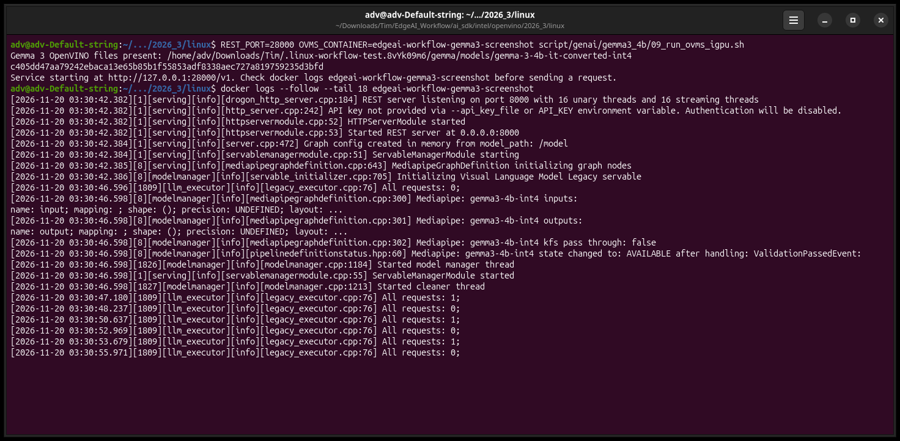
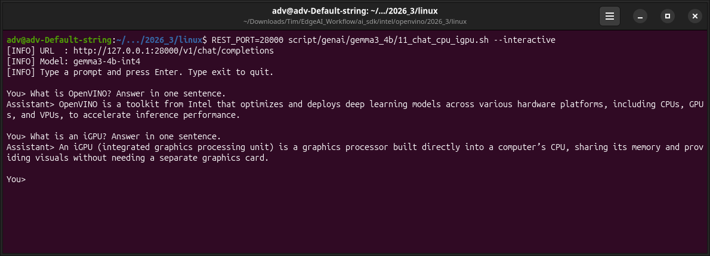

# How to convert Gemma 3 4B VLM with Intel OpenVINO and inference with OVMS

This guide prepares Gemma 3 4B OpenVINO INT4 IR and serves it with OpenVINO Model Server on an Advantech Edge AI Intel platform. CPU and iGPU can use a locally converted or a prepared model. The NPU flow uses the prepared channel-wise INT4 model.

- [Environment](#environment)
  - [Target](#target)
  - [Conversion Requirements](#conversion-requirements)
- [Model Preparation](#model-preparation)
  - [CPU / iGPU Model](#cpu--igpu-model)
  - [NPU Model](#npu-model)
  - [Hugging Face Access](#hugging-face-access)
- [Script Workflow](#script-workflow)
  - [Configuration](#configuration)
  - [Convert CPU / iGPU Model](#convert-cpu--igpu-model)
  - [Use Prepared Models](#use-prepared-models)
- [Deploy](#deploy)
  - [Prepare OVMS](#prepare-ovms)
  - [Run OVMS](#run-ovms)
  - [Run Chat Client](#run-chat-client)
- [Result](#result)
- [Reference](#reference)

# Environment

Base on Edge AI SDK for Linux, Docker Engine, Bash and curl.

## Target

| Item | Content | Note |
| --- | --- | --- |
| Platform | Advantech Edge AI Intel platform, Panther Lake | CPU / iGPU / NPU |
| OS | Ubuntu 26.04 x86_64 | Bash terminal |
| Python | 3.11 | Isolated environment for original-model conversion |
| SDK runtime | OpenVINO 2026.3.0 | Host SDK |
| OVMS | `openvino/model_server:2026.4.1-gpu` | Official Linux image. Includes its own OpenVINO runtime |

## Conversion Requirements

| Item | Recommended |
| --- | --- |
| RAM | 32 GB or more recommended for exporting and quantizing the original model |
| Disk | 60 GB or more of free disk space for the original weights, intermediate IR, and final INT4 model |
| Network | Hugging Face, Python package indexes and Docker Hub |
| Hugging Face account | Authorized access to Google's original Gemma 3 4B model |
| Conversion tools | uv, PyTorch CPU 2.7.1, Optimum Intel 2.1.0, OpenVINO 2026.3.0 and Hugging Face CLI |

If uv is not on your PATH, install it in a separate tooling environment:

~~~bash
sudo apt install -y python3-venv curl ca-certificates
python3 -m venv "$HOME/.local/share/edgeai-workflow-tools"
"$HOME/.local/share/edgeai-workflow-tools/bin/python" -m pip install uv
export PATH="$HOME/.local/share/edgeai-workflow-tools/bin:$PATH"
~~~

The prepared-model path uses curl and Docker.

# Model Preparation

## CPU / iGPU Model

| Method | Source | Default Model Path | Note |
| --- | --- | --- | --- |
| Convert the original model | `google/gemma-3-4b-it` | `$WORKSPACE/models/gemma-3-4b-it-converted-int4` | Intel OpenVINO export workflow |
| Download prepared OpenVINO IR | `Advantech-EIOT/intel_google-gemma-3-4b-it-int4` | `$WORKSPACE/models/gemma-3-4b-it-int4` | Direct download |

The OVMS scripts select `--target_device CPU` or `--target_device GPU` and serve the model as `gemma3-4b-int4`.

## NPU Model

| Method | Source | Default Model Path | Note |
| --- | --- | --- | --- |
| Download prepared channel-wise INT4 OpenVINO IR | `Advantech-EIOT/intel_google-gemma-3-4b-it-int4-cw-ov` | `$WORKSPACE/models/gemma-3-4b-it-int4-cw-ov` | OVMS model ID `gemma3-4b-npu` |
| Download official prepared OpenVINO IR | `OpenVINO/gemma-3-4b-it-int4-cw-ov` | `$WORKSPACE/models/gemma-3-4b-it-int4-cw-ov-openvino` | Requires Hugging Face model access |

The CPU/iGPU export produces the model for those two devices. The NPU run uses a prepared channel-wise IR and serves it as `gemma3-4b-npu`.

## Hugging Face Access

For original-model conversion, sign in and accept the access terms on the Google Gemma repository in your browser. Use the same Hugging Face account when logging in from the conversion environment. The direct Advantech downloads are public. [Google Gemma 3 4B model page](https://huggingface.co/google/gemma-3-4b-it)

~~~bash
"$WORKSPACE/envs/gemma3_4b_convert/bin/hf" auth login
~~~

An existing `HF_TOKEN` exported in the current shell also works. If the test download below returns HTTP 401 or 403, use `hf auth whoami` to check the account and verify that the account and its token have access to the gated model.

# Script Workflow

The scripts are located in `ai_sdk/intel/openvino/2026_3/linux/script/genai/gemma3_4b`.

| Script | Purpose |
| --- | --- |
| `00_config.sh` | Workspace, model paths, Docker image and API port |
| `01_check_env.sh` | Shows Docker and available Intel device nodes |
| `02_prepare_workspace.sh` | Creates workspace directories |
| `03_prepare_convert_env.sh` | Creates the isolated Python 3.11 environment |
| `04_download_raw_model.sh` | Downloads the original Gemma 3 4B model |
| `05_convert_openvino_int4.sh` | Converts the original model with Optimum Intel |
| `06_check_converted_model.sh` | Checks the OpenVINO model files |
| `download_prepared_models.sh` | Downloads the prepared CPU/iGPU and NPU models |
| `07_check_ovms.sh` | Checks Docker and prepares the pinned OVMS image |
| `08_run_ovms_cpu.sh`, `09_run_ovms_igpu.sh`, `10_run_ovms_npu.sh` | Start one OVMS device |
| `11_chat_cpu_igpu.sh`, `12_chat_npu.sh` | Send a test prompt or start interactive chat using the matching model ID |
| `run_all_convert.sh` | Runs preparation, download, export and model checks |

## Configuration

From the repository root:

~~~bash
cd ai_sdk/intel/openvino/2026_3/linux
export WORKSPACE="$HOME/edgeai-workflow/gemma3_4b"
script/genai/gemma3_4b/01_check_env.sh
~~~

| Variable | Default |
| --- | --- |
| `WORKSPACE` | `$HOME/edgeai-workflow/gemma3_4b` |
| `CPU_IGPU_MODEL_PATH` | `$WORKSPACE/models/gemma-3-4b-it-converted-int4` |
| `NPU_MODEL_PATH` | `$WORKSPACE/models/gemma-3-4b-it-int4-cw-ov` |
| `REST_PORT` | `18000` |
| `OVMS_CONTAINER` | `edgeai-workflow-gemma3` |
| `GPU_NODE` | `/dev/dri/renderD128` |
| `NPU_NODE` | `/dev/accel/accel0` |

If the port is already in use, export a different `REST_PORT` in both the server and client terminals.

## Convert CPU / iGPU Model

Prepare the workspace and isolated conversion environment:

~~~bash
export CPU_IGPU_MODEL_PATH="$WORKSPACE/models/gemma-3-4b-it-converted-int4"
script/genai/gemma3_4b/02_prepare_workspace.sh
script/genai/gemma3_4b/03_prepare_convert_env.sh
~~~

Log in and confirm access with a small file download before fetching the model weights:

~~~bash
HF="$WORKSPACE/envs/gemma3_4b_convert/bin/hf"
"$HF" auth login
"$HF" auth whoami
"$HF" download google/gemma-3-4b-it config.json
~~~

Download the full original model, export it to INT4, and check the resulting IR:

~~~bash
script/genai/gemma3_4b/04_download_raw_model.sh
script/genai/gemma3_4b/05_convert_openvino_int4.sh
script/genai/gemma3_4b/06_check_converted_model.sh
~~~

After authenticating, `script/genai/gemma3_4b/run_all_convert.sh` runs the full conversion sequence. The export uses `--task image-text-to-text --weight-format int4`. Expect pairs of XML and BIN files for the language model, text and vision embeddings, tokenizer and detokenizer.

Optimum Intel writes an intermediate, uncompressed IR before quantizing. The script defaults to `$WORKSPACE/tmp` for these files. If you set `TMPDIR` yourself, choose a writable directory on a disk with sufficient free space. A RAM-backed `/tmp` can run out of space during export.

## Use Prepared Models

~~~bash
script/genai/gemma3_4b/02_prepare_workspace.sh
script/genai/gemma3_4b/download_prepared_models.sh
export CPU_IGPU_MODEL_PATH="$WORKSPACE/models/gemma-3-4b-it-int4"
~~~

| Device | Repository | Fixed revision |
| --- | --- | --- |
| CPU / iGPU | `Advantech-EIOT/intel_google-gemma-3-4b-it-int4` | `f6d934fa4caf62db9f1290d89c6269dfb96f9b12` |
| NPU | `Advantech-EIOT/intel_google-gemma-3-4b-it-int4-cw-ov` | `e3d5536c0cfc2380168b088527fe1c1aed8d5972` |

The download script also accepts `cpu` or `npu`. It stages the model files and checks the expected IR pairs before publishing the model directory. Its explicit file list allows OVMS to generate the graph for the selected device.

### Official OpenVINO NPU model

Accept the Gemma terms on the OpenVINO model repository, then sign in through the Hugging Face CLI with the same account. If you prepared the conversion environment earlier, you can use its `hf` executable. [OpenVINO Gemma 3 4B channel-wise INT4 model](https://huggingface.co/OpenVINO/gemma-3-4b-it-int4-cw-ov)

~~~bash
hf auth login
export NPU_MODEL_PATH="$WORKSPACE/models/gemma-3-4b-it-int4-cw-ov-openvino"
hf download OpenVINO/gemma-3-4b-it-int4-cw-ov --local-dir "$NPU_MODEL_PATH"
~~~

Use the same shell for the NPU launch step so the script picks up `NPU_MODEL_PATH`.

# Deploy

## Prepare OVMS

~~~bash
script/genai/gemma3_4b/07_check_ovms.sh
~~~

The image is pinned by digest in `00_config.sh`. GPU mode maps `/dev/dri` and NPU mode maps `/dev/accel`. The scripts assign the groups of the configured device nodes to the process inside the container.

## Run OVMS

Start one device at a time. The scripts use the same loopback port and container name.

~~~bash
script/genai/gemma3_4b/08_run_ovms_cpu.sh
docker logs edgeai-workflow-gemma3
curl --fail --silent --show-error http://127.0.0.1:18000/v1/models
~~~

To switch to iGPU:

~~~bash
docker rm -f edgeai-workflow-gemma3
script/genai/gemma3_4b/09_run_ovms_igpu.sh
~~~

To switch to NPU with the prepared channel-wise model:

~~~bash
docker rm -f edgeai-workflow-gemma3
script/genai/gemma3_4b/10_run_ovms_npu.sh
~~~

The NPU run uses `--cache_size 0 --enable_prefix_caching false`. After each switch, check the container log and wait for `/v1/models` to list the expected model before sending a request.

To watch the OVMS logs live, keep this command running in the OVMS terminal and open another terminal for the chat client.

~~~bash
docker logs --follow edgeai-workflow-gemma3
~~~

Press Ctrl+C to leave the log view. The OVMS container keeps running.

## Run Chat Client

Install `jq` for interactive chat.

~~~bash
sudo apt install -y jq
~~~

CPU or iGPU:

~~~bash
script/genai/gemma3_4b/11_chat_cpu_igpu.sh --interactive
~~~

NPU:

~~~bash
script/genai/gemma3_4b/12_chat_npu.sh --interactive
~~~

Enter a question at the `You>` prompt. The reply appears under `Assistant>`, followed by another input prompt. Type `exit` to leave the chat.

Run either script without `--interactive` to send the test prompt to `/v1/chat/completions` and print the raw JSON response.

Stop the OVMS container when done:

~~~bash
docker rm -f edgeai-workflow-gemma3
~~~

# Result

OVMS running on iGPU, with live logs and the REST API on local port `28000`

Interactive Chat Client on iGPU after two questions

In single-request mode, the generated text is in `choices[0].message.content`.

The prepared Advantech models were downloaded and tested on CPU, iGPU and NPU. All three runs returned a reply from the chat API. After converting the original model, run the model file check and start OVMS on CPU or iGPU using the local conversion output path.

| Device | Model Path | OVMS Script | Chat Script |
| --- | --- | --- | --- |
| CPU | `CPU_IGPU_MODEL_PATH` | `08_run_ovms_cpu.sh` | `11_chat_cpu_igpu.sh` |
| iGPU | `CPU_IGPU_MODEL_PATH` | `09_run_ovms_igpu.sh` | `11_chat_cpu_igpu.sh` |
| NPU | `NPU_MODEL_PATH` | `10_run_ovms_npu.sh` | `12_chat_npu.sh` |

# Reference

- [Intel OpenVINO Gemma 3 notebook](https://github.com/openvinotoolkit/openvino_notebooks/blob/latest/notebooks/gemma3/gemma3.ipynb)
- [OpenVINO Model Server releases](https://github.com/openvinotoolkit/model_server/releases)
- [Google Gemma 3 4B](https://huggingface.co/google/gemma-3-4b-it)
- [Advantech CPU/iGPU model](https://huggingface.co/Advantech-EIOT/intel_google-gemma-3-4b-it-int4)
- [Advantech channel-wise NPU model](https://huggingface.co/Advantech-EIOT/intel_google-gemma-3-4b-it-int4-cw-ov)
- [Official OpenVINO channel-wise NPU model](https://huggingface.co/OpenVINO/gemma-3-4b-it-int4-cw-ov)
