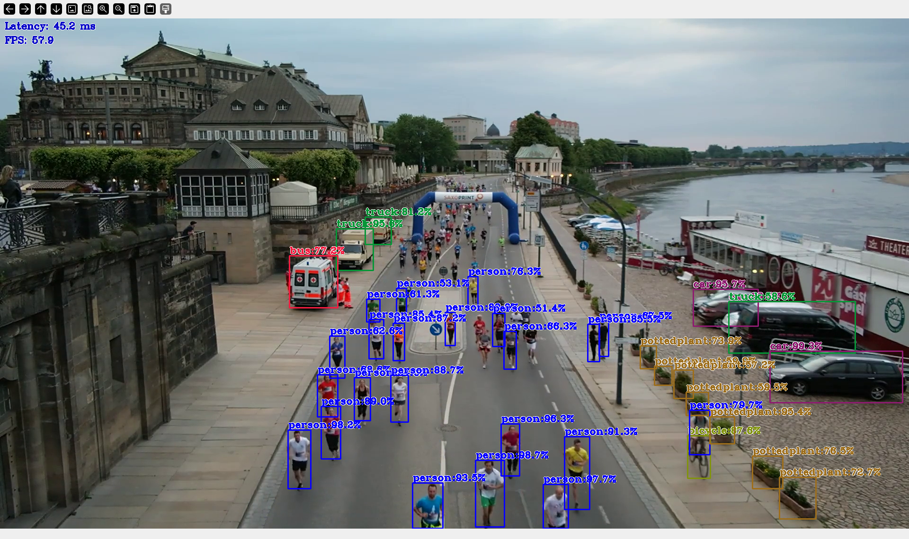

# Create an Object Detection

This example prepares OpenVINO object detection models and runs the Open Model Zoo Object Detection C++ demo on an Advantech Edge AI Intel platform. It covers the official model download and conversion workflow and a faster setup using Advantech's prepared YOLOv4-TF IR.

Run the Bash scripts under `script/object_detection` from a Linux terminal.

- [Environment](#environment)
  - [Target](#target)
  - [Required Tools](#required-tools)
  - [Model Selection](#model-selection)
  - [Model Conversion](#model-conversion)
- [Script Workflow](#script-workflow)
  - [Configuration](#configuration)
  - [Full Setup](#full-setup)
  - [Step-by-step Setup](#step-by-step-setup)
  - [YOLOv4-TF Setup](#yolov4-tf-setup)
- [Deploy](#deploy)
- [Result](#result)
- [Reference](#reference)

# Environment

Base on Edge AI SDK for Linux with the OpenVINO 2026.3.0 native runtime installed.

## Target

| Item | Content | Note |
| --- | --- | --- |
| Platform | Advantech Edge AI Intel platform, Panther Lake | CPU / iGPU / NPU |
| OS | Ubuntu 26.04 x86_64 | Bash terminal |
| Runtime | OpenVINO 2026.3.0 | SDK libraries under `runtime/openvino_2026_3/lib` |
| Default model | `ssd_mobilenet_v1_coco` | Open Model Zoo |
| Optional model | `yolo-v4-tf` | Open Model Zoo conversion or Advantech prepared FP16 IR |

## Required Tools

| Tool | Check Command | Note |
| --- | --- | --- |
| Git, curl | `git --version`, `curl --version` | Source and model downloads |
| CMake, GCC C++ | `cmake --version`, `g++ --version` | Builds the C++ demo |
| OpenCV development libraries | `dpkg-query -W libopencv-dev` | Ubuntu OpenCV 4.10 |
| Python 3 and venv | `python3 --version` | Build-time OpenVINO CMake files |
| uv / Python 3.10 | `uv --version` | Required for the original-model conversion steps |

~~~bash
sudo apt update
sudo apt install -y git curl ca-certificates cmake g++ libopencv-dev libgflags-dev python3-venv
~~~

For the conversion steps, prepare uv if it is not already on your PATH:

~~~bash
python3 -m venv "$HOME/.local/share/edgeai-workflow-tools"
"$HOME/.local/share/edgeai-workflow-tools/bin/python" -m pip install uv
export PATH="$HOME/.local/share/edgeai-workflow-tools/bin:$PATH"
~~~

Availability of the iGPU and NPU depends on the installed Intel drivers and device permissions. After the SDK adds your account to the render group, open a new login session if the group is not visible in `id`.

## Model Selection

| Model | Architecture type | Script set | Note |
| --- | --- | --- | --- |
| `ssd_mobilenet_v1_coco` | `ssd` | `04`, `05`, `07`–`09` | Official OMZ download and conversion |
| `yolo-v4-tf` | `yolo` | `10`–`14` | Official OMZ download and conversion or Advantech prepared FP16 IR |

The scripts select the Open Model Zoo post-processing mode using `-at ssd` or `-at yolo`.

## Model Conversion

These two TensorFlow model recipes use the Open Model Zoo tools bundled with the legacy OpenVINO development package. The C++ demo source and the SDK inference runtime use the 2026.3 release.

| Item | Introduction | Version |
| --- | --- | --- |
| Python | Isolated conversion environment | 3.10 |
| NumPy | Conversion dependency | 1.26.4 |
| OpenCV | Ubuntu C++ development libraries | 4.10 |
| Open Model Zoo | Source for the C++ demo | `releases/2026/3`, commit `7cc29a91472b4cb1289a11e655ba3e188e1d4a31` |
| OpenVINO | Native C++ inference | 2026.3.0 |
| openvino-dev | `omz_downloader` and `omz_converter` | 2024.6.0 |
| tensorflow-cpu | TensorFlow conversion and YOLOv4 pre-convert | 2.15.1 |

| Step | `ssd_mobilenet_v1_coco` | `yolo-v4-tf` |
| --- | --- | --- |
| Download | TensorFlow SSD assets | Darknet weights, configuration and Keras converter assets |
| Pre-convert | None | OMZ generates `yolo-v4.savedmodel` |
| Model Optimizer | TensorFlow model to FP16 IR | SavedModel to FP16 IR |
| Demo architecture | `-at ssd` | `-at yolo` |

# Script Workflow

The scripts are located in `ai_sdk/intel/openvino/2026_3/linux/script/object_detection`.

| Script | Purpose |
| --- | --- |
| `00_config.sh` | Workspace, SDK runtime path, model paths and source revision |
| `check_env.sh` | Checks the tools and SDK runtime |
| `01_prepare_workspace.sh` | Creates workspace directories and checks out OMZ and its gflags submodule |
| `02_prepare_convert_env.sh` | Creates the isolated Python 3.10 conversion environment |
| `03_prepare_runtime_env.sh` | Installs OpenVINO 2026.3.0 CMake development files in a build environment |
| `04_download_model.sh`, `05_convert_model.sh` | Download and convert the default SSD model |
| `06_build_demo.sh` | Builds `object_detection_demo` with CMake |
| `07_run_cpu.sh`, `08_run_igpu.sh`, `09_run_npu.sh` | Run the default SSD model |
| `10_download_yolov4_tf.sh`, `11_convert_yolov4_tf.sh` | Download and convert YOLOv4-TF |
| `download_prepared_yolov4.sh` | Downloads and checks the Advantech YOLOv4-TF FP16 files |
| `12_run_yolov4_cpu.sh`, `13_run_yolov4_igpu.sh`, `14_run_yolov4_npu.sh` | Run YOLOv4-TF |
| `run_all_setup.sh`, `run_all_yolov4_setup.sh` | Run the full setup for the chosen locally converted model |

## Configuration

From the repository root, change to the Linux workflow directory:

~~~bash
cd ai_sdk/intel/openvino/2026_3/linux
~~~

| Variable | Default |
| --- | --- |
| `WORKSPACE` | `$HOME/edgeai-workflow/vision` |
| `SDK_ROOT` | `/opt/Advantech/EdgeAI/System/Intel/SDK` |
| `OV_RUNTIME` | `$SDK_ROOT/runtime/openvino_2026_3/lib` |
| `DEMO_INPUT` | `/opt/Advantech/EdgeAI/Main/Data/video/ObjectDetection.mp4` |
| `BUILD_JOBS` | `2` |

Set `DEMO_INPUT` or pass a video path to any run script if the sample video is unavailable.

## Full Setup

~~~bash
script/object_detection/check_env.sh
script/object_detection/run_all_setup.sh
~~~

The setup prepares the workspace, conversion and build environments, downloads and converts SSD MobileNet, and builds the C++ demo.

## Step-by-step Setup

~~~bash
script/object_detection/01_prepare_workspace.sh
script/object_detection/02_prepare_convert_env.sh
script/object_detection/03_prepare_runtime_env.sh
script/object_detection/04_download_model.sh
script/object_detection/05_convert_model.sh
script/object_detection/06_build_demo.sh
~~~

The conversion script explicitly uses Model Optimizer and Python from the isolated conversion environment.

The SSD IR is written to `$WORKSPACE/models/public/ssd_mobilenet_v1_coco/FP16/`. The compiled demo is at `$WORKSPACE/build/intel64/Release/object_detection_demo`.

## YOLOv4-TF Setup

### Download and convert using Open Model Zoo

~~~bash
script/object_detection/run_all_yolov4_setup.sh
~~~

With the common setup complete, the two model steps can run separately:

~~~bash
script/object_detection/10_download_yolov4_tf.sh
script/object_detection/11_convert_yolov4_tf.sh
~~~

The output is `yolo-v4-tf.xml` and `yolo-v4-tf.bin` under `$WORKSPACE/models/public/yolo-v4-tf/FP16/`.

### Download Advantech's prepared FP16 model

~~~bash
script/object_detection/check_env.sh
script/object_detection/01_prepare_workspace.sh
script/object_detection/03_prepare_runtime_env.sh
script/object_detection/download_prepared_yolov4.sh
script/object_detection/06_build_demo.sh
~~~

This downloads `Advantech-EIOT/Intel_yolo-v4-tf_FP16` at revision `b5165e2297d85ed898e1e11d0c3ec36a0e101ecc`, checks its XML and BIN against the published manifest, downloads its license, and writes them under `$WORKSPACE/models/advantech/yolo-v4-tf/FP16/`. Only the C++ demo is built on this route.

# Deploy

Run the default SSD model:

~~~bash
script/object_detection/07_run_cpu.sh
script/object_detection/08_run_igpu.sh
script/object_detection/09_run_npu.sh
~~~

Run the locally converted YOLOv4-TF model:

~~~bash
script/object_detection/12_run_yolov4_cpu.sh
script/object_detection/13_run_yolov4_igpu.sh
script/object_detection/14_run_yolov4_npu.sh
~~~

Run the Advantech IR:

~~~bash
export YOLO_SOURCE=prepared
script/object_detection/12_run_yolov4_cpu.sh
script/object_detection/13_run_yolov4_igpu.sh
script/object_detection/14_run_yolov4_npu.sh
unset YOLO_SOURCE
~~~

For a terminal check without a video window, pass a short video. The demo exits at the end of the input:

~~~bash
YOLO_SOURCE=prepared DEMO_HEADLESS=1 \
  script/object_detection/12_run_yolov4_cpu.sh /path/to/video.mp4
~~~

The run scripts load the SDK's native OpenVINO libraries and run the compiled C++ binary directly. The Python environments are used for conversion or build setup.

# Result

YOLOv4-TF FP16 example on iGPU

With a graphical session, expect a video window with bounding boxes and a looping input. The headless check reports the selected device and performance metrics in the terminal.

The Linux C++ demo was built from the pinned OMZ source and replayed with a short video in headless mode.

| Model preparation | CPU | iGPU | NPU |
| --- | --- | --- | --- |
| OMZ download and conversion — SSD MobileNet | Passed | Passed | Passed |
| OMZ download and conversion — YOLOv4-TF | Passed | Passed | Passed |
| Advantech prepared IR — YOLOv4-TF | Passed | Passed | Passed |

| Model | Device | Script | Command Option |
| --- | --- | --- | --- |
| SSD MobileNet | CPU | `07_run_cpu.sh` | `-at ssd -d CPU` |
| SSD MobileNet | iGPU | `08_run_igpu.sh` | `-at ssd -d GPU` |
| SSD MobileNet | NPU | `09_run_npu.sh` | `-at ssd -d NPU` |
| YOLOv4-TF | CPU | `12_run_yolov4_cpu.sh` | `-at yolo -d CPU` |
| YOLOv4-TF | iGPU | `13_run_yolov4_igpu.sh` | `-at yolo -d GPU` |
| YOLOv4-TF | NPU | `14_run_yolov4_npu.sh` | `-at yolo -d NPU` |

# Reference

- [Open Model Zoo Object Detection C++ demo](https://github.com/openvinotoolkit/open_model_zoo/tree/7cc29a91472b4cb1289a11e655ba3e188e1d4a31/demos/object_detection_demo/cpp)
- [Open Model Zoo model tools](https://github.com/openvinotoolkit/open_model_zoo/tree/7cc29a91472b4cb1289a11e655ba3e188e1d4a31/tools/model_tools)
- [Advantech YOLOv4-TF FP16](https://huggingface.co/Advantech-EIOT/Intel_yolo-v4-tf_FP16)
